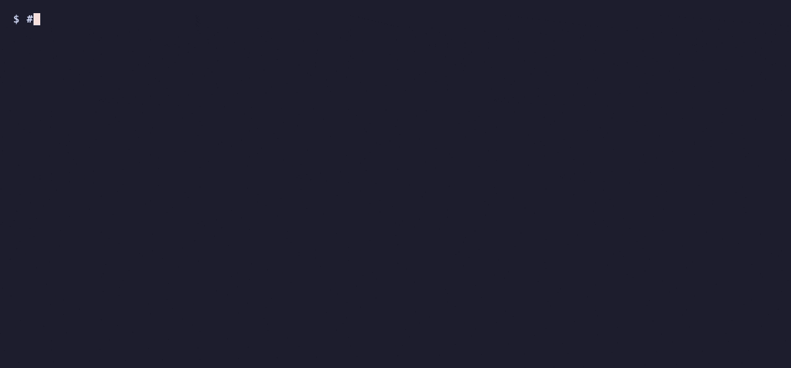

# brioctl

brioctl gives an AI agent — or you — eyes and hands for a webcam on macOS: read every setting, change it, grab a frame
and measure it, all from one small CLI.

Logitech's apps for the MX Brio are heavy, want an account and cannot be scripted. And settings drift: the camera
forgets some when it loses power or when a call starts the video.

```sh
brew install petrochen/tap/brioctl            # the CLI
brew install --cask petrochen/tap/brioctl-app # the menu bar app
brioctl install-skill                         # teach Claude Code and Codex to use it
```



Works with Claude Code, Codex, Cursor, Raycast AI, any agent with a shell — no MCP server needed.

```sh
brioctl auto --json                      # measure the face, fix exposure and white balance, report what changed
brioctl capture --json | jq .avg.face.y_mean   # a frame and its numbers: brightness of the face
brioctl expcomp +10 --dry-run            # preview a change, write nothing
brioctl undo                             # put back what the last command replaced
```

- A menu bar app with global hotkeys for field of view and zoom.
- `watch` re-applies your settings when the camera connects and when video starts.
- Any UVC camera: the Logitech MX Brio in full, other Brio models and generic webcams with the standard controls.


Not affiliated with or endorsed by Logitech. See [Disclaimer](#disclaimer).

## Commands

One C file talking to the camera through IOKit: no driver, no root, no third-party library. The camera stays free for
other apps, so settings change while video streams. `brioctl help` lists every setting; `brioctl describe` explains
them with ranges, settle times and risks.

| Command                                   | What it does                                                                                          |
| ----------------------------------------- | ----------------------------------------------------------------------------------------------------- |
| `brioctl [--json]`                        | Show all settings of the camera, as text or one JSON object                                           |
| `brioctl list [--json]`                   | List the UVC cameras; `--camera ID` (index, serial or location) picks one                             |
| `brioctl get NAME`                        | Print one value; exit status 1 if unreadable                                                          |
| `brioctl NAME VALUE ...`                  | Change settings: `fov 78 zoom 115 hdr off`; manual `exposure`, `wb`, `focus` need their auto mode off |
| `brioctl expcomp +10 warmth -5`           | Relative values, clamped to the camera's range; `fov +` / `fov -` step the angle                      |
| `--dry-run [--json]`                      | With a change, `apply`, `defaults` or `undo`: print `NAME old -> new`, write nothing                  |
| `brioctl undo`                            | Put back what the last changing command replaced; a second `undo` redoes it                           |
| `--save`                                  | After a change: run `brioctl save`, so `watch` keeps it                                               |
| `brioctl save [NAME]` / `apply [NAME]`    | Store or restore settings (`~/.config/brioctl/NAME`) or a preset                                      |
| `brioctl profiles [--json]`               | List the presets (`neutral warmer cooler bw standard streaming colorboost`) and files                 |
| `brioctl import optionsplus [DB]`         | Turn the settings Logi Options+ saved into a settings file; needs no camera                           |
| `brioctl defaults`                        | Camera defaults, except `mic`, `showmode` and `privacy`                                               |
| `brioctl factory-reset --yes`             | Restart the MX Brio with factory settings, then restore yours                                         |
| `brioctl capture [--stats] [--json]`      | JPEG frames (`-o`, `--count`, `--interval`, `--wait`, `--size`) with picture numbers                  |
| `brioctl describe [--json]`               | What every control means, its range, settle time and risk; read-only                                  |
| `brioctl auto [--dry-run] [--save]`       | Measure, nudge `expcomp`, `hdr`, `warmth`, measure again (see below)                                  |
| `brioctl install-skill [--uninstall]`     | Copy the agent skill into every `~/.claude/skills` and `~/.codex/skills` that exists                  |
| `brioctl watch [FILE]`                    | Apply a settings file now, on connect and on video start                                              |
| `brioctl dump`, `brioctl snapshot [FILE]` | Read-only: every unit and register; a bug report with the serial masked                               |

A settings file is plain text, one `name value` per line; `save` starts it with `# camera VID:PID SERIAL`, so remove
that line before you post it. Text and JSON output contain the camera's serial number too. When several settings are
given in one command, `mic` is written last because the camera restarts after it.

### capture and auto

`capture` grabs frames through AVFoundation, even while a call uses the camera, and measures them: `y_mean`, `y_p5`,
`y_p95`, `clip_low_pct`, `clip_high_pct`, `wb_bias` (r/b), `sharpness` and the same over the largest face (Vision:
`face`, `face_fraction`, `face_center`). macOS asks for camera access once; if it is denied the exit status is 3.

`auto` is a handful of rules, not a model. It measures the face (the whole frame if there is none) on the average of
two frames, waits 2 s after each change (3.5 s after framing), takes up to 4 steps and stops with `in_range`,
`no_improvement`, `oscillating` (a control would go back to a value it had in this run), `max_steps` or `dry_run`.
Every change goes through the normal path, so `--dry-run`, `--save` and one `undo` for the whole run work.

| Rule          | When                                            | What                                            |
| ------------- | ----------------------------------------------- | ----------------------------------------------- |
| exposure      | `y_mean` under 105 or over 140 (frame: 90-140)  | `expcomp` +/-10, kept in 96-176                 |
| highlights    | frame `clip_high_pct` over 3, `y_mean` in range | `hdr on` (once); if already on, a note          |
| shadows       | `clip_low_pct` over 5, `y_mean` not over 140    | `hdr on`, else `expcomp` +8 (kept in 96-176)    |
| white balance | `wb_bias` over 1.12 or under 0.90               | `warmth` -/+4 (30-70); `awb` off: `wb` -/+300 K |
| framing       | `face_fraction` under 0.04                      | a note; `--framing`: `fov -`, then `zoom +25`   |
| focus         | frame `sharpness` under half of the first frame | a note only                                     |

`auto` never touches `mic` or `privacy`, and `fov` and `zoom` only with `--framing`. `--json` prints `steps`, `before`,
`after`, `applied`, `recommendations`, `note`, `saved` and `stopped`.

## Agents

`brioctl --json` and `brioctl describe --json` read, `brioctl auto --json` makes a first measured adjustment,
`brioctl NAME VALUE` changes by hand, `brioctl capture --json` verifies.
[skills/brioctl/SKILL.md](skills/brioctl/SKILL.md) is the whole guide for an agent: the controls, how to read the
numbers, what never to touch. `brioctl install-skill`
copies it (no link) from next to the binary, else from `share/brioctl/skills/` (Homebrew, `make install`), else from
the text built into the binary; run it again after an update. Errors are plain text on stderr; exit status 1 is an
error, 2 a wrong command line or no camera chosen, 3 camera access denied.

## Keeping settings: watch

`brioctl save` stores the current settings in `~/.config/brioctl/settings`; `make agent` (or `brew services start
brioctl`, or "Re-apply settings automatically" in the app) runs `brioctl watch` at login. `watch` applies the file at
start, when the camera connects, and 2 s after video starts (HID report on the MX Brio, CoreMediaIO for any camera).
Settings you change by hand and do not save are reverted at the next video start: add `--save`.

- It follows one camera: the MX Brio, else the only experimental one, else the serial you give with `--camera`. It
  never applies MX Brio settings to another webcam and waits quietly when none is connected.
- It never changes `mic` while video is on, skips `fov`, `zoom`, `pan` and `tilt` while Show Mode shows the desk, never
  applies `privacy`, and refuses a file saved from another model. The log is `~/Library/Logs/brioctl.log`.

## Menu bar app

`brioctl.app` shows the settings of the chosen camera in a small window, a control per setting, with a presets menu. It
runs the CLI inside it (no camera permission needed), needs macOS 13, is ad-hoc signed and has no Dock icon. The gear
opens its settings: re-apply automatically, launch at login and global hotkeys (⌃⌥⌘1/2/3 for `fov 90/78/65`, ⌃⌥⌘0
`zoom 100`, ⌃⌥⌘= and ⌃⌥⌘- zoom by 25). While a `watch` agent is installed the app saves its changes for it.
`brioctl://` URLs work from Shortcuts: `open "brioctl://set?fov=78&zoom=115"`, `brioctl://apply?name=warmer`,
`brioctl://camera?id=2`.
A copy downloaded by a browser needs "Open Anyway" in System Settings, or `xattr -dr com.apple.quarantine
/Applications/brioctl.app`. Build it with `make app`; see [app/README.md](app/README.md).

## Supported cameras

`brioctl list` shows every USB device with a UVC VideoControl interface and its support level:

| Camera                          | USB id (`VID:PID`)   | Support        | What brioctl does                                                                                                 |
| ------------------------------- | -------------------- | -------------- | ----------------------------------------------------------------------------------------------------------------- |
| Logitech MX Brio                | `046d:0944`          | `full`         | Standard controls, field of view, Show Mode, `hdr`, warmth, tint, vibrance, `expcomp`, `mic`, `smooth`, `micgain` |
| Logitech Brio                   | `046d:085e`          | `experimental` | Standard controls, field of view, `hdr`                                                                           |
| Logitech Brio 500               | `046d:0943`          | `experimental` | Standard controls, field of view, Show Mode, `hdr`                                                                |
| Logitech Brio 501 / 505         | `046d:0946` / `0919` | `experimental` | Standard controls, field of view (backlight is `backlight`)                                                       |
| Logitech Brio 4K Stream Edition | `046d:086b`          | `experimental` | Standard controls, field of view, `hdr`                                                                           |
| Every other UVC camera          | any                  | `standard`     | The standard controls the camera declares; no extension unit is written                                           |

Only the MX Brio (firmware 1.1.394) is tested on hardware; the experimental rows follow
[cameractrls](https://github.com/soyersoyer/cameractrls) and an
[OpenLogi issue](https://github.com/AprilNEA/OpenLogi/issues/1222). Send `brioctl snapshot report.snap` if you own one
([COMPATIBILITY.md](COMPATIBILITY.md), [docs/registers.md](docs/registers.md)).
Without `--camera`, brioctl uses the only camera, or the only one it knows; if it cannot choose it prints the list and
exits with status 2.

## Install and safety

macOS 12 or later, Apple Silicon or Intel. Homebrew: see the top. From the release tarball, `xattr -d
com.apple.quarantine brioctl` and `install -m 755 brioctl ~/bin/` (the binary is ad-hoc signed, not notarized). From
source (Xcode or the Command Line Tools): `make && make install`, `make universal` for both architectures, `make app`
for the menu bar app, `make test` and `make test-app` for the offline tests.

brioctl writes only the controls in its own table, only inside the range the camera reports, and reads every value
back. It never writes the factory reset, flash lock, lens motor, restart, calibration, debug or firmware registers
(except `factory-reset --yes`), and never writes a value an automatic mode is setting. `privacy` is only set by hand.
None of this is a guarantee. The MX Brio has no working indicator LED, RightLight or firmware update through brioctl.

## Related projects

[cameractrls](https://github.com/soyersoyer/cameractrls) (Linux), [OpenLogi](https://github.com/AprilNEA/OpenLogi),
[uvc-util](https://github.com/jtfrey/uvc-util) (macOS, standard UVC controls). MIT, see [LICENSE](LICENSE).

## Disclaimer

brioctl is an independent project. It is not affiliated with, authorized by or endorsed by Logitech. Logitech, MX Brio
and other product names are trademarks of their owners, and they are used here only to name the hardware the tool
works with.

The software is provided as is, without warranty. It sends commands to the firmware of your camera, using
undocumented controls. Use it at your own risk.
