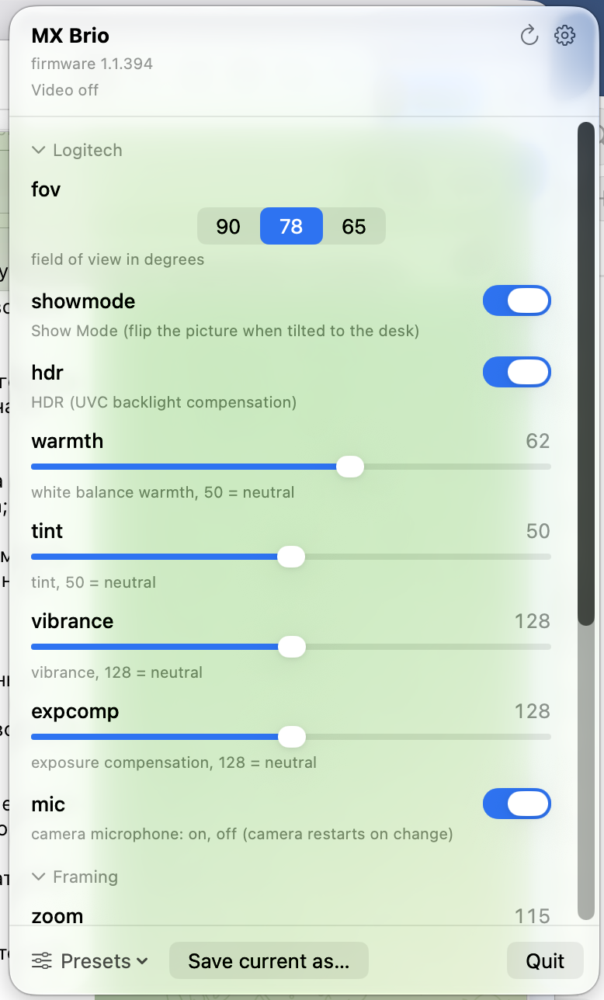

# brioctl

Logitech's apps for the MX Brio are heavy, want an account, and cannot be scripted. If all you need is to set the field
of view, turn HDR off or keep your settings after a reconnect, that is a lot to run.

**brioctl** reads and changes the settings of UVC webcams on macOS without the manufacturer's software: a command-line
tool and a menu bar app for the Logitech MX Brio and any other UVC camera.

```sh
brew install petrochen/tap/brioctl            # CLI
brew install --cask petrochen/tap/brioctl-app # menu bar app
```




The command-line tool is one C file that talks to the camera through IOKit. It needs no driver, no root and no
third-party library. The [menu bar app](#menu-bar-app) gives the same controls in a window.

Not affiliated with or endorsed by Logitech. See [Disclaimer](#disclaimer).

## Features

- Any UVC camera: it offers the standard controls the camera declares (exposure, white balance, focus, zoom, brightness
  and so on) with the ranges the camera reports. `brioctl list` shows the cameras, `--camera` picks one, and `brioctl`
  lists the controls: exposure, gain, white balance, focus, brightness, contrast, hue, gamma, sharpness, zoom, pan,
  tilt, roll, iris, privacy shutter and more. See [Supported cameras](#supported-cameras).
- For the Logitech MX Brio (USB `046d:0944`), the settings that Logitech's apps control through the camera: field of
  view (90, 78 or 65 degrees), Show Mode, HDR, white balance warmth, tint, vibrance, exposure compensation, camera
  microphone on and off. The field of view is also available, as an experimental feature, on a few other Brio models.
- Zoom, pan and tilt (digital on the Logitech cameras), and on the MX Brio smooth zoom: zoom and pan glide to the new
  value in about 3 seconds.
- The macOS input volume of the camera microphone (`micgain`, MX Brio).
- `watch`, a LaunchAgent that re-applies your settings when the camera is connected and when video starts, for any
  camera.
- Presets, including `colorboost`, and named settings files: `save` and `apply`.
- `import optionsplus` turns the settings Logi Options+ saved for the camera into a settings file, without a camera.
- A [menu bar app](#menu-bar-app) with the same controls, global hotkeys and a `brioctl://` URL scheme for Shortcuts.
- `--json` output and `get NAME` for scripts.
- `snapshot` for bug reports, `defaults` to go back to the camera's default values, and `factory-reset` to restart the
  MX Brio with factory settings and then restore yours.
- A read-only `dump` of every unit and extension control the camera has.

### Compared with

|                                        | brioctl       | Logi Tune        | Logi Options+    | Generic "Webcam Settings" app |
| -------------------------------------- | ------------- | ---------------- | ---------------- | ----------------------------- |
| No background agents, no sign-in       | yes           | background agent | background agent | —                             |
| Scriptable (CLI, `--json`, URL scheme) | yes           | no               | no               | —                             |
| MX Brio field of view, Show Mode, HDR  | yes           | yes              | yes              | —                             |
| Re-applies settings on connect         | yes (`watch`) | —                | —                | —                             |
| Open source                            | yes (MIT)     | no               | no               | —                             |
| Price                                  | free          | free             | free             | —                             |

A dash means that it depends on the app or that it was not checked.

## Menu bar app

`brioctl.app` puts the controls in the menu bar. Click the camera icon and a small window shows the settings of the
chosen camera, grouped as in `brioctl show` (Logitech, Framing, Exposure and image, Found in the firmware). Each one
has the control its kind and range call for: a switch, a segmented control, a menu or a slider. A line under the camera
name says whether video is on and whether the camera shows the desk. With several cameras a menu at the top picks one.
The Presets menu applies a preset or a saved file, and "Save current as..." stores the camera's settings under a name.

The app contains the command-line tool (`brioctl.app/Contents/Resources/brioctl`) and does everything through it: it
reads `--json` and changes settings with the commands you would type. It never opens the camera itself, so it needs no
camera permission. It needs macOS 13 or later, on Apple Silicon or Intel, and has no Dock icon.

Install it with Homebrew:

```sh
brew install --cask petrochen/tap/brioctl-app
```

Or download `brioctl-app-1.1.0.zip` from the GitHub releases page, unzip it and move `brioctl.app` to `/Applications`.
The app is ad-hoc signed and not notarized, so macOS refuses the first launch of a copy that a browser downloaded. Open
System Settings, Privacy & Security, and choose "Open Anyway" for brioctl, or remove the quarantine attribute before
you start it:

```sh
xattr -dr com.apple.quarantine /Applications/brioctl.app
```

The Homebrew cask removes the attribute for you. To build the app yourself, run `make app` (it needs Swift, which comes
with Xcode and the Command Line Tools) and open `app/build/brioctl.app`. See [app/README.md](app/README.md).

The gear icon opens the app's settings:

- **Re-apply settings automatically** saves the current settings and installs the LaunchAgent
  `com.github.petrochen.brioctl`, which runs `brioctl watch` with the tool inside the app (see
  [Apply settings automatically](#apply-settings-automatically)). An agent that `make agent` or Homebrew
  (`homebrew.mxcl.brioctl`) installed is left alone, and the app works with it.
- **Launch at login** writes `~/Library/LaunchAgents/com.github.petrochen.brioctl.app.plist`, which opens the app when
  you log in. It works from the packaged `brioctl.app` only.
- **Global hotkeys** are off until you switch them on. They need no Accessibility permission, act on the chosen camera
  and do nothing when the camera lacks the control. If another app already uses a key, the settings page says so.

  | Keys | Action     |
  | ---- | ---------- |
  | ⌃⌥⌘1 | `fov 90`   |
  | ⌃⌥⌘2 | `fov 78`   |
  | ⌃⌥⌘3 | `fov 65`   |
  | ⌃⌥⌘0 | `zoom 100` |
  | ⌃⌥⌘= | `zoom` +25 |
  | ⌃⌥⌘- | `zoom` −25 |

**Changes made in the app are saved for auto-apply.** `brioctl watch` puts `~/.config/brioctl/settings` back when the
camera connects and when video starts, which would undo a change made in the app. So while an agent with the label
`com.github.petrochen.brioctl` or `homebrew.mxcl.brioctl` is installed, whoever installed it, the app runs
`brioctl [--camera ID] save` about a second after its last change: a slider, a menu, a preset, a hotkey or a URL. A
burst of slider moves gives one save, and the window shows "Saved for auto-apply" when it is done. If the agent follows
another camera than the chosen one, the app leaves the file alone. With no agent installed the app saves nothing on its
own; "Remember current settings" in the settings writes the file once.

**URL scheme.** The app handles `brioctl://` URLs, for the Open URLs action in Shortcuts and for scripts. They start the
app when it is not running:

```sh
open "brioctl://set?fov=78&zoom=115"    # change settings of the chosen camera
open "brioctl://apply?name=warmer"      # apply a preset or a saved file
open "brioctl://camera?id=2"            # choose the camera: an index, a serial number or a location
```

A URL can only change settings, apply a preset or a saved file, and choose the camera. Names the camera does not have
are ignored, and so are values that are not plain words or numbers.

## Requirements

- macOS 12 or later, on Apple Silicon or Intel. The menu bar app needs macOS 13.
- A UVC camera. Full support is for the Logitech MX Brio (`046d:0944`), tested with firmware 1.1.394. See
  [Supported cameras](#supported-cameras) for the others.
- To build from source: Xcode or the Command Line Tools (`xcode-select --install`).

## Install

With Homebrew:

```sh
brew install petrochen/tap/brioctl
```

From the release tarball (a universal binary for Apple Silicon and Intel), from the GitHub releases page:

```sh
tar xzf brioctl-1.1.0-macos-universal.tar.gz
cd brioctl-1.1.0-macos-universal
xattr -d com.apple.quarantine brioctl   # only needed if a browser downloaded the tarball
install -m 755 brioctl ~/bin/brioctl
```

The binary is ad-hoc signed and not notarized, so macOS quarantines a tarball downloaded with a browser and refuses
to run `brioctl` from it. The `xattr` command removes the quarantine attribute. Homebrew and builds from source are
not affected.

From source:

```sh
make && make install
```

`make install` copies the binary to `~/bin` by default. Choose another place with `PREFIX`:

```sh
make && sudo make install PREFIX=/usr/local   # installs /usr/local/bin/brioctl
```

`make universal` builds a binary for both Apple Silicon and Intel (macOS 12 or later), and `make dist` packs it with
the README and the license into `brioctl-VERSION-macos-universal.tar.gz`. `make app` builds the
[menu bar app](#menu-bar-app) (`app/build/brioctl.app`) and `make app-zip` packs it into
`app/build/brioctl-app-VERSION.zip`; neither is part of `make`.

## Usage

```sh
brioctl                              # show all settings of the camera
brioctl list                         # the UVC cameras brioctl finds (add --json for scripts)
brioctl --camera 2 fov 78            # use another camera: an index or serial number from the list, or a location
brioctl --json                       # the same as one JSON object, for scripts
brioctl get fov                      # print one value only (settings and micgain); exit code 1 if unreadable
brioctl fov 78 zoom 115 flicker 50   # change one or more settings
brioctl hdr off                      # hdr and backlight are one control: both names, on/off or 1/0
brioctl ae manual exposure 150       # manual values need the automatic mode switched off first
brioctl micgain 0.28                 # input volume of the camera microphone in macOS
brioctl smooth on                    # zoom and pan glide to the new value (about 3 s)
brioctl save                         # save the current settings to ~/.config/brioctl/settings
brioctl save meeting                 # or to ~/.config/brioctl/meeting
brioctl apply                        # put the saved settings back (apply meeting, apply warmer, ...)
brioctl profiles [--json]            # list the presets and the saved files
brioctl import optionsplus [DB]      # the settings Logi Options+ saved, as a settings file (--save NAME writes it)
brioctl defaults                     # camera default values, except mic, showmode and privacy; no restart
brioctl factory-reset --yes          # restart the MX Brio with factory settings, then restore yours
brioctl watch [FILE]                 # apply now, on connect and on video start (see below)
brioctl dump                         # all units and registers of the camera, read-only
brioctl snapshot [FILE]              # every register brioctl reads, serial number masked
brioctl --version
brioctl help
```

`--camera ID` may stand anywhere in the line; see [Supported cameras](#supported-cameras). When several settings are
given in one command, `mic` is written last: changing it restarts the camera.

A settings file is plain text: one `name value` per line, and `#` starts a comment. `save` starts it with the line
`# camera VID:PID SERIAL`. `apply` prints a warning when the file was saved from another model and still applies the
settings that fit; `watch` does not apply such a file at all. The line holds the camera's serial number, so remove it
before you post the file.

## Supported cameras

`brioctl list` finds every USB device that has a UVC VideoControl interface and says how far brioctl supports it:

```
#   id         name                     model                    support       serial         location
1   046d:0944  MX Brio                  MX Brio                  full          XXXXXXXXXXXX   0x110000
2   1234:5678  Some Cam                 -                        standard      ABC123         0x120000
```

| Camera                          | USB id (`VID:PID`) | Support        | What brioctl does                                                                                                                                               |
| ------------------------------- | ------------------ | -------------- | --------------------------------------------------------------------------------------------------------------------------------------------------------------- |
| Logitech MX Brio                | `046d:0944`        | `full`         | Everything in this document: the standard controls, field of view, Show Mode, `hdr`, warmth, tint, vibrance, exposure compensation, `mic`, `smooth`, `micgain`. |
| Logitech Brio                   | `046d:085e`        | `experimental` | The standard controls, field of view, and the backlight compensation under the name `hdr`.                                                                      |
| Logitech Brio 500               | `046d:0943`        | `experimental` | The standard controls, field of view, Show Mode, and `hdr`.                                                                                                     |
| Logitech Brio 501               | `046d:0946`        | `experimental` | The standard controls and field of view. The backlight compensation is called `backlight`.                                                                      |
| Logitech Brio 505               | `046d:0919`        | `experimental` | The same as the Brio 501.                                                                                                                                       |
| Logitech Brio 4K Stream Edition | `046d:086b`        | `experimental` | The standard controls, field of view, and `hdr`.                                                                                                                |
| Every other UVC camera          | any                | `standard`     | The standard UVC controls the camera declares. brioctl never writes to an extension unit of such a camera.                                                      |

The `experimental` rows come from what other projects report: [cameractrls](https://github.com/soyersoyer/cameractrls)
(v0.6.10) lists these product ids for the field of view, and an
[OpenLogi issue](https://github.com/AprilNEA/OpenLogi/issues/1222) about a Brio 500 reports the field of view, Show
Mode and the HDR switch. brioctl was not tested with any of these cameras. The sources and the details are in
[docs/registers.md](docs/registers.md#experimental-models). If you have one, please run `brioctl snapshot report.snap`
and send the file; `brioctl` itself says so in one line under the camera's name.

For a standard control to appear, the camera has to declare it in its descriptor (the control bitmaps of its camera
terminal and processing unit, see [docs/registers.md](docs/registers.md#standard-controls-of-other-cameras)). The
ranges `brioctl` shows are the camera's own (`GET_MIN` and `GET_MAX`). The backlight compensation control is called
`hdr` on the Logitech cameras that have an HDR switch and `backlight` on the others. Either name is accepted on every
camera, and so are both styles of value: `on` and `off`, or numbers (`1` and `0` where the camera has the switch, the
camera's own range where it has a number).

**Choosing the camera.** `--camera ID` chooses one for every command. ID is the index, the serial number or the USB
location from the list. `brioctl list --json` prints the same as `{"cameras":[{"index":1,"vid":"046d",...}]}`. Without
`--camera`, brioctl uses the only camera, or, if there are several, the only one it knows (support `full` or
`experimental`). If it cannot choose, it prints the list and exits with status 2. `watch` has its own rules, described
in [Apply settings automatically](#apply-settings-automatically): without `--camera` it never takes a camera it does
not know.

## Example output

```
MX Brio  firmware 1.1.394  serial XXXXXXXXXXXX  colour code 2

Status (read-only)
  video       on, 1920x1080
  led         on
  desk view   off
  rightsight  off, speed normal, framing normal (stored for Logitech's app)

Logitech (mapped from Logi Tune)
  fov         78        default 90                    field of view in degrees: 90, 78, 65
  showmode    on        default off                   Show Mode (flip the picture when tilted to the desk): on, off
  hdr         on        default on                    HDR (UVC backlight compensation): on, off
  warmth      62        default 50        0-100       white balance warmth, 50 = neutral
  tint        50        default 50        0-100       tint, 50 = neutral
  vibrance    128       default 128       0-255       vibrance, 128 = neutral
  expcomp     128       default 128       0-255       exposure compensation, 128 = neutral
  mic         on        default off                   camera microphone: on, off (camera restarts on change)

Framing
  zoom        115       default 100       100-400     zoom, 100 = 1x on Logitech cameras
  pan         0         default 0         -20..20     move the zoomed frame, in degrees
  tilt        0         default 0         -20..20     move the zoomed frame, in degrees

Exposure and image (standard UVC)
  priority    exposure  default ?                     in low light keep: fps, exposure
  ae          auto      default auto                  auto exposure: auto, manual
  exposure    1250*     default 156       3-2047      exposure time in 100 us units (ae manual)
  gain        0*        default 0         0-255       gain
  flicker     50        default 60                    anti-flicker, mains frequency in Hz: 50, 60
  brightness  128       default 128       0-255       brightness
  contrast    128       default 128       0-255       contrast
  saturation  128       default 128       0-255       saturation
  sharpness   128       default 128       0-255       sharpness
  awb         on        default on                    auto white balance: on, off
  wb          4100*     default 5000      2800-7500   white balance in kelvin (awb off)
  af          on        default on                    autofocus: on, off
  focus       14*       default 0         0-255       focus (af off)

Found in the firmware, not used by Logitech's apps
  smooth      off       default off                   glide to new zoom and pan in about 3 s: on, off

Microphone (macOS)
  micgain     0.2785    default -         0-1         input volume

* set automatically right now
```

A `*` after a value means an automatic mode (`ae`, `awb`, `af`) is setting it right now. You can write such a value
only after switching the automatic mode off, and `save` does not store it.

The Status section is shown for the MX Brio only. It reports whether video is running and at what resolution, whether
the indicator LED is on, whether the camera is tilted to the desk (Show Mode) and what is stored in the RightSight
settings block. Another camera is shown with its name, `VID:PID` and serial number, then one line (`experimental
support: ...` or `standard UVC controls only`), then only the settings it has.

`brioctl`, `brioctl --json`, `brioctl list`, `brioctl dump` and the `# camera` line of a file written by `brioctl save`
carry the camera's serial number. Mask it before you post them. `brioctl snapshot` and `tools/hidmon` already do.

`brioctl help` lists all setting names. What a camera has depends on the camera: `brioctl` shows only the settings it
has, with its own range for each number.

## Settings

| Name         | Values                                | Where    | What it does                                                                                                                 |
| ------------ | ------------------------------------- | -------- | ---------------------------------------------------------------------------------------------------------------------------- |
| `fov`        | `90`, `78`, `65` (degrees)            | Logitech | Field of view. A digital crop.                                                                                               |
| `showmode`   | `on`, `off`                           | Logitech | Show Mode. When the camera is tilted down to the desk it switches to a desk view and sets the field of view and zoom itself. |
| `hdr`        | `on`, `off`                           | Logitech | HDR. This is the UVC backlight compensation control. It lifts the shadows.                                                   |
| `warmth`     | 0 to 100, 50 is neutral               | MX Brio  | White balance warmth, from blue to warm.                                                                                     |
| `tint`       | 0 to 100, 50 is neutral               | MX Brio  | Tint.                                                                                                                        |
| `vibrance`   | 0 to 255, 128 is neutral              | MX Brio  | Vibrance.                                                                                                                    |
| `expcomp`    | 0 to 255, 128 is neutral              | MX Brio  | Exposure compensation.                                                                                                       |
| `mic`        | `on`, `off`                           | MX Brio  | Camera microphone. The camera restarts about 2 seconds after a change.                                                       |
| `zoom`       | 100 to 400 (100 is 1x)                | declared | Digital zoom. 100 is 1x on the Logitech cameras.                                                                             |
| `pan`        | -20 to 20 (degrees)                   | declared | Moves the zoomed frame sideways. Decimals are accepted and rounded to the camera's unit.                                     |
| `tilt`       | -20 to 20 (degrees)                   | declared | Moves the zoomed frame up and down. Decimals as for `pan`.                                                                   |
| `roll`       | degrees, may be negative              | declared | Rotates the picture.                                                                                                         |
| `priority`   | `fps`, `exposure`                     | declared | What to keep in low light: the frame rate or the exposure time.                                                              |
| `ae`         | `auto`, `manual`, `shutter`           | declared | Auto exposure. `exposure` and `gain` can be written only in `manual`. `shutter` only where the camera lists it.              |
| `exposure`   | 3 to 2047 (units of 100 microseconds) | declared | Exposure time.                                                                                                               |
| `iris`       | number (f-number times 100)           | declared | Iris.                                                                                                                        |
| `gain`       | 0 to 255                              | declared | Sensor gain.                                                                                                                 |
| `backlight`  | number, or `on`, `off`                | declared | Backlight compensation. The same control as `hdr`, for a camera without an HDR switch.                                       |
| `flicker`    | `50`, `60` (Hz)                       | declared | Anti-flicker: the frequency of the mains power. `off` and `auto` where the camera lists them.                                |
| `brightness` | 0 to 255; signed on some cameras      | declared | Brightness. Default 128 on the MX Brio.                                                                                      |
| `contrast`   | 0 to 255                              | declared | Contrast. Default 128 on the MX Brio.                                                                                        |
| `hueauto`    | `on`, `off`                           | declared | Automatic hue.                                                                                                               |
| `hue`        | number, may be negative               | declared | Hue. Can be written only with `hueauto` off.                                                                                 |
| `saturation` | 0 to 255                              | declared | Saturation. Default 128 on the MX Brio.                                                                                      |
| `sharpness`  | 0 to 255                              | declared | Sharpness. Default 128 on the MX Brio.                                                                                       |
| `gamma`      | number                                | declared | Gamma.                                                                                                                       |
| `awb`        | `on`, `off`                           | declared | Automatic white balance.                                                                                                     |
| `wb`         | 2800 to 7500 (kelvin)                 | declared | White balance temperature. Can be written only with `awb` off.                                                               |
| `af`         | `on`, `off`                           | declared | Autofocus.                                                                                                                   |
| `focus`      | 0 to 255                              | declared | Focus. Can be written only with `af` off.                                                                                    |
| `privacy`    | `on`, `off`                           | declared | Privacy shutter. Many cameras only report it. Never saved, reset or applied by `watch`: set it by hand only.                 |
| `smooth`     | `on`, `off`                           | MX Brio  | Zoom and pan glide to a new value in about 3 seconds. The camera forgets it on power loss.                                   |
| `micgain`    | 0 to 1                                | MX Brio  | Input volume of the camera microphone in macOS. Not a camera register.                                                       |

`brioctl help` prints the same list in this order. The **Where** column says which cameras have the setting:
`MX Brio`; `Logitech` for the models in [Supported cameras](#supported-cameras) that list it (`fov` on all of them,
`showmode` on the MX Brio and the Brio 500, `hdr` on the MX Brio, Brio, Brio 500 and Brio 4K Stream Edition); and
`declared` for any camera whose descriptor declares the control. The values in the table are those of the MX Brio.
Other cameras have their own ranges and choices, which `brioctl` shows, and `ae`, `flicker` and `backlight` list what
the camera accepts. The camera's own default for each setting is in the `default` column of the output above.[^defaults]

Numbers follow the range the camera reports. brioctl writes a number only inside the `GET_MIN` to `GET_MAX` range of the
camera: a control that does not report a range is refused with `range unknown, not writing`, and `save` leaves such a
number out. `pan` and `tilt` are in degrees and the camera stores them in arc seconds, so `pan 1.5` is rounded to the
nearest arc second; the MX Brio may accept whole degrees only.

[^defaults]:
    For `showmode` and `mic` the camera reports "off" as the default, but after a factory reset the firmware
    turns both on. See [Factory reset](docs/registers.md#factory-reset) in the register notes. `brioctl defaults`
    leaves those two settings alone for this reason, and `privacy` too.

## Presets

`brioctl apply NAME` accepts these names as well as saved files:

| Preset       | Sets                          |
| ------------ | ----------------------------- |
| `neutral`    | `warmth 50`, `saturation 128` |
| `warmer`     | `warmth 60`                   |
| `cooler`     | `warmth 40`                   |
| `bw`         | `saturation 0`                |
| `standard`   | `priority exposure`           |
| `streaming`  | `priority fps`                |
| `colorboost` | `saturation 255`              |

A preset that names a setting the camera does not have (`warmth` on a camera other than the MX Brio) reports it as not
found, applies the rest and exits with status 1.

`colorboost` needs an explanation. The camera has a hidden Color Boost switch that doubles the saturation, but it is
lost when the video restarts and when saturation is written. `saturation 255` gives the same picture from the default
128, and the camera keeps it, so the preset uses that. The measurements are in [docs/registers.md](docs/registers.md).

## Import from Logi Options+

If Logi Options+ has set up your camera, `brioctl import optionsplus` turns the settings it saved into a brioctl
settings file. That helps after a power loss or a factory reset, or when you remove Logi Options+ and want the same
picture. It needs no camera and writes nothing to the camera or to the app's files.

```sh
brioctl import optionsplus                         # print the settings file
brioctl import optionsplus --save fromapp          # write it to ~/.config/brioctl/fromapp instead
brioctl apply fromapp                              # put it on the camera
brioctl import optionsplus ~/backup/settings.db    # read a copy of the database
```

It reads `~/Library/Application Support/LogiOptionsPlus/settings.db`, or the file you name. The output starts with
`# imported from ...` and `# camera 046d:0944` comments (so `apply` and `watch` know which model the file is for), then
one `name value` line per setting. What it did not take over (`# skipped:` lines) and what is doubtful (`# check:`
lines) is said on stderr, once, and is not in the file, so the file is the same on a screen, in a pipe and with
`--save`. Short example, as a terminal shows it (the `# skipped:` lines come on stderr):

```
# imported from Logi Options+ 2.9.994631 on 2026-11-01 22:17
# camera 046d:0944
# MX Brio, profile PROFILE_NAME_DEFAULT
fov 78
showmode on
...
awb on
af on
micgain 0.2785
# skipped: mic (Logi Options+ does not keep the camera microphone on or off; apply leaves it as it is)
# skipped: videoPreview (no brioctl equivalent)
```

What it takes, for the preset each card of the app has selected in the profile `PROFILE_NAME_DEFAULT` (the first
profile if there is none of that name), and the MX Brio first if the app knows several cameras:

| Logi Options+                                 | brioctl                                               |
| --------------------------------------------- | ----------------------------------------------------- |
| field of view 90, 78, 65; Show Mode; HDR      | `fov`, `showmode`, `hdr`                              |
| warmth, tint, vibrance, exposure compensation | `warmth`, `tint`, `vibrance`, `expcomp`               |
| zoom                                          | `zoom`                                                |
| low-light priority                            | `priority exposure` or `fps`                          |
| automatic exposure                            | `ae auto`                                             |
| anti-flicker 50 or 60                         | `flicker`                                             |
| brightness, contrast, saturation, sharpness   | the same names (only when set to manual)              |
| white balance: automatic                      | `awb on`                                              |
| white balance: manual                         | `awb off`, `wb`, with a `# check:` notice (see below) |
| autofocus                                     | `af on`                                               |
| microphone volume (input)                     | `micgain`                                             |

What it leaves out, and why:

- Manual exposure time and gain. The numbers in Logi Options+ are its own scale and were not matched to the camera's
  units, so a manual exposure is skipped as a whole (`ae`, `exposure`, `gain`).
- Manual focus, and pan or tilt away from the centre: the scale of the numbers is not known. Pan and tilt at the centre
  become `pan 0` and `tilt 0`.
- Manual white balance is imported as kelvin, which is probably what it is but has not been checked against the
  camera, so brioctl prints a `# check:` notice for it. Values outside 2800 to 7500 are skipped.
- RightSight (Logitech's app does the framing on the computer), the video preview, background blur and the like: they
  are not camera settings. They are listed by name when the app has them on.
- The camera microphone on and off (`mic`). The app does not keep it in this file, so the imported file has no `mic`
  line and `apply` leaves the microphone as it is.
- A field the app left out is not guessed. Optional ones (HDR, Show Mode, tint, anti-flicker) give no line and no
  notice; any other missing or out-of-range field gets a `# skipped:` notice.

The format was read from Logi Options+ 2.9.994631 (settings schema 26). Another schema version is imported too, with a
`# check:` notice. A file that does not look like Logi Options+ settings is an error that names the schema
version it found. The database is opened read-only and immutable, so a running Logi Options+ is not disturbed, but
changes it still holds in `settings.db-wal` are not seen. When that file exists, Logi Options+ is running (or did not
quit cleanly): brioctl prints a warning on stderr, and quitting the app before the import fixes it. Logi Tune is not
supported: it keeps no settings file, so there is nothing to import. Run `brioctl save` while the camera has your
settings instead.

## JSON

`brioctl --json` prints one JSON object on one line, for scripts and apps (the menu bar app is built on `--json`,
`list --json` and `profiles --json`). Errors are not JSON: they go to stderr as text with a non-zero exit status (1 for
an error, 2 when the camera cannot be chosen or the command line is wrong). A shortened example, formatted for reading:

```json
{
  "device": {
    "model": "MX Brio",
    "firmware": "1.1.394",
    "serial": "XXXXXXXXXXXX",
    "colour": 2,
    "name": "MX Brio",
    "vid": "046d",
    "pid": "0944",
    "support": "full",
    "index": 1,
    "location": "0x110000"
  },
  "status": {
    "video": { "on": true, "width": 1920, "height": 1080 },
    "led": true,
    "desk_view": false,
    "rightsight": {
      "stored": true,
      "enabled": false,
      "speed": "normal",
      "framing": "normal"
    }
  },
  "settings": {
    "fov": {
      "value": "78",
      "default": "90",
      "auto": false,
      "group": "Logitech",
      "writable": true,
      "kind": "choice",
      "choices": ["90", "78", "65"],
      "help": "field of view in degrees: 90, 78, 65"
    },
    "hdr": {
      "value": "on",
      "default": "on",
      "auto": false,
      "group": "Logitech",
      "writable": true,
      "kind": "bool",
      "help": "..."
    },
    "warmth": {
      "value": 62,
      "default": 50,
      "auto": false,
      "group": "Logitech",
      "writable": true,
      "kind": "number",
      "min": 0,
      "max": 100,
      "step": 1,
      "help": "white balance warmth, 50 = neutral"
    }
  },
  "micgain": 0.2785
}
```

- `device`: `model` (the name in brioctl's table, or null), `name` (the USB product name), `vid` and `pid` (four hex
  digits), `support` (`full`, `experimental` or `standard`), `index`, `location` (a string such as `0x110000`),
  `serial` (the USB serial number, the one `list` and `--camera` use) and `firmware` and `colour` (the MX Brio's own
  registers). A value the camera does not give is null.
- `status`: `video` (`{"on":…,"width":…,"height":…}`), `led`, `desk_view` and `rightsight` (`{"stored":false}` or
  `{"stored":true,"enabled":…,"speed":…,"framing":…}`). All four are null on a camera other than the MX Brio.
- `settings`: one entry for each setting the camera has, named as on the command line and in the order of
  `brioctl help`. Each has `value`, `default` (null if the camera has none), `auto` (an automatic mode drives it now),
  `group` (`Logitech`, `Framing`, `Exposure and image` or `Found in the firmware`), `writable` (it can be set and no
  automatic mode drives it now), `kind` (`number`, `choice` or `bool`) and `help`.
  - A `number` has JSON numbers for `value` and `default` (pan, tilt and roll in degrees) and `min`, `max` and `step`,
    scaled like the value.
  - A `choice` has strings, and `choices`: the names the camera accepts, for example `["50","60"]`.
  - A `bool` has the strings `"on"` and `"off"`, not JSON booleans.
- `micgain`: the macOS input volume of the MX Brio's microphone, or null.

`brioctl list --json` prints `{"cameras":[{"index":1,"vid":"046d","pid":"0944","name":"MX Brio","model":"MX Brio",
"support":"full","serial":"...","location":"0x110000"}]}`. `brioctl profiles --json` prints
`{"presets":[{"name":"warmer","settings":{"warmth":"60"}}],"saved":["meeting","settings"],
"dir":"/Users/you/.config/brioctl"}`. `brioctl get NAME` prints one value as `show` writes it (`on`, `78`, `62`) and
exits with 1 if the camera cannot read it.

## Apply settings automatically

The camera forgets some settings when it loses power, and image settings can be lost when video starts.
`brioctl watch` puts your settings back:

```sh
brioctl save        # store the current settings in ~/.config/brioctl/settings
make agent          # install brioctl to PREFIX/bin and start "brioctl watch" at login
make unagent        # remove it again
```

With Homebrew, `brew services start brioctl` does the same. The [menu bar app](#menu-bar-app) can install the agent
too, and keeps the settings file up to date when you change something in it.

`make agent` installs a LaunchAgent with the label `com.github.petrochen.brioctl` in `~/Library/LaunchAgents`. If
`~/.config/brioctl/settings` does not exist yet, it saves the current settings first. The log is
`~/Library/Logs/brioctl.log`.

`watch` follows one camera. Without `--camera` it is the only camera with full support (the MX Brio), or else the only
one with experimental support. It never takes a camera brioctl does not know, so an agent that starts while the MX Brio
is unplugged does not apply MX Brio settings to some other webcam. To follow any other camera, give its serial number:
`brioctl --camera SERIAL watch` (the app puts this into its agent when it is needed; the index from `list` changes when
cameras come and go).

What `watch` does:

- It applies `~/.config/brioctl/settings` (or the file you name: `brioctl watch FILE`) when it starts and every time
  the camera is connected. A camera that is still starting up is retried a few times.
- When video starts, `watch` waits 2 seconds and applies the file again, because image settings can be lost when the
  stream starts. It has two ways to see the start. The MX Brio announces it with HID report `0x40`. For every camera,
  `watch` also listens to CoreMediaIO: the property `DeviceIsRunningSomewhere` of the camera's device changes from false
  to true while some app starts to use the camera. Reading and listening to it does not open the camera and needs no
  camera permission. Both signals feed the same timer, so one start gives one apply. See
  [docs/registers.md](docs/registers.md#video-start-through-coremediaio).
- With no camera to follow, or no clear choice (no camera it knows, several MX Brios, or several experimental cameras
  and no MX Brio), it says why once, keeps running and looks again when a camera is connected and every 5 seconds. It
  never exits: launchd would only start it again at once. The camera is found again after a reconnect, also on another
  port, by its vendor id, product id and serial number; a camera without a serial number only at its location.
- It never changes `mic` while video is on. The camera restarts after that write, which would cut the picture and the
  sound in the middle of a call. If the file differs from the camera, the log says `mic: not changed while video is on`.
- While the MX Brio shows the desk (Show Mode, `desk view on` in the status), it skips `fov`, `zoom`, `pan` and `tilt`.
  The camera sets those itself at that moment. The log has one line about it. A manual `brioctl apply` is not affected.
- It never applies `privacy`, even if the file has the line. A shutter is not a preference to restore. The log says
  `not applied by watch, set by hand only: privacy`. `brioctl apply` still applies it.
- It refuses a settings file that was saved from another model (the `# camera VID:PID` line differs from the camera it
  follows). It logs that once per connect and applies nothing, because `watch` would otherwise repeat it at every
  connect and every video start. Save the file again from the right camera.
- It logs only the settings it actually changed. The lines `HID listening`, `HID device removed`,
  `CoreMediaIO listening` and `CoreMediaIO device removed` show whether `watch` is listening to the camera after the
  camera has restarted. If macOS does not let `watch` open the HID interface of the MX Brio, it logs a warning and sees
  video start through CoreMediaIO only.

A log looks like this:

```
2026-11-01 17:57:38 video started
fov 90
warmth 55
2026-11-01 17:57:38 mic: not changed while video is on
2026-11-01 17:57:38 applied (2 changed)
```

and, with no camera it knows:

```
2026-11-01 18:02:11 no camera known to brioctl is connected, waiting for one (--camera ID watches another)
```

## Safety

brioctl writes to the camera, so it is careful about what it writes.

- It writes only the controls in its own table. Everything else is read-only. A standard control is written only if the
  camera declares it in its descriptor.
- Logitech extension units are written only on the models in the [table of supported cameras](#supported-cameras), and
  only the controls each model is known to have: the field of view on all of them, Show Mode on the Brio 500 and the
  MX Brio, the rest on the MX Brio. On any other camera, brioctl writes standard UVC controls only, and `dump` reads no
  value of an extension unit it does not know. The field of view and Show Mode take the named values from brioctl's own
  table, never a number taken from the camera's `GET_MAX` (the field of view reports 255 as its maximum and only 0, 1
  and 2 do anything).
- It never writes these registers: the factory reset (except for `factory-reset --yes`), the flash lock, the lens
  motor and lens memory service command, the restart command, the factory optics calibration switch, the chip debug
  unit and the chip command and firmware update unit. What each one does is described in
  [docs/registers.md](docs/registers.md#registers-brioctl-never-writes).
- For the Logitech extension controls it first reads the control's size (`GET_LEN`) and `GET_INFO`. If the firmware has
  changed the layout, or the control does not say it can be written, the write is cancelled. A standard control that
  `GET_INFO` says cannot be written is refused too.
- It refuses to write a value that an automatic mode is setting right now.
- A number is written only inside the `GET_MIN` to `GET_MAX` range the camera reports, and only if it fits the control.
  Without a range brioctl writes nothing (`range unknown, not writing`).
- Pan and tilt share one register, and `smooth` shares one with its speed. The other fields are read first and kept.
- A value that is already set is not written again, which avoids needless flash wear and camera restarts.
- After each write it reads the value back. If the camera did not keep it, brioctl says so and exits with an error.
- `save` leaves out values that the camera would not accept, numbers the camera gives no range for, and `privacy`.
- `privacy` is only set on purpose, by name. `save` never writes it, `defaults` never resets it and `watch` never
  applies it; `brioctl privacy on` and `apply` of a file that has the line do.
- `import optionsplus` never opens the camera. It opens Logi Options+'s database read-only and immutable, so SQLite
  creates, locks and changes nothing in the app's folder. It uses only the camera settings in the document; the
  account data stored beside them is never printed or kept.
- `factory-reset` works on the MX Brio only. It does nothing without `--yes`. With it, your settings are saved to
  `~/.config/brioctl/before-reset` first and applied again after the camera is back.
- `dump` asks the service registers, and all registers of an extension unit it does not know, only for `GET_INFO` and
  `GET_LEN`. `snapshot` never reads the value of the factory reset or the flash lock. `tools/hidmon` and
  `tools/uvcwatch` have no write code at all.

None of this is a guarantee. You write to your camera at your own risk.

## What the MX Brio cannot do

- The indicator LED. The camera ignores LED writes. Retail units are locked in a state where the firmware drops them.
- RightLight. The register exists and accepts a write, but nothing changes in the picture, the exposure or the gain.
  The function has no effect in this firmware.
- RightSight auto-framing. It is done by Logitech's desktop app on the computer. The camera only stores the app's
  settings. brioctl shows them in the status but does not do any framing.
- Firmware updates. Not supported. A wrong write to that part of the camera can damage it.
- The state of the privacy shutter. The camera does not report it, and it declares no UVC privacy control, so `privacy`
  is not offered for it.

## How it works

brioctl sends USB Video Class requests (`GET_CUR`, `SET_CUR`, `GET_MIN` and so on) to the camera's VideoControl
interface with `IOUSBDeviceInterface::DeviceRequestTO`. The device is not opened or seized, so the camera driver keeps
working, settings can be changed while video is streaming, and no root is needed. The units are found by reading the
configuration descriptor, and the Logitech extension units by their GUID. The standard controls a camera has are the
ones its camera terminal and processing unit declare in their `bmControls`
([how the bits map to controls](docs/registers.md#standard-controls-of-other-cameras)). `watch` sees video start through
a HID report (MX Brio) and through CoreMediaIO (any camera).

The standard controls follow the UVC specification. The Logitech extension controls are not documented by Logitech.
The register map in [docs/registers.md](docs/registers.md) comes from observing Logitech's apps, from analysing the
camera firmware for interoperability, and from tests on a real camera, and every fact in it is marked as measured or
inferred.

`micgain` is different: the camera microphone's input volume is kept by macOS, so it is set through CoreAudio.

## Testing

```sh
make test       # the command-line tool
make test-app   # the menu bar app: unit tests of its Swift package (app/README.md)
```

The tests run without a camera. The same `brioctl.c` is built with `-DBRIOCTL_FAKE`, and a camera emulator answers its
requests from a register snapshot, `tests/mxbrio-1.1.394.snap`, which was taken from a real MX Brio with
`brioctl snapshot`. `BRIOCTL_FAKE` can name several snapshots separated by `:`, which gives several cameras for `list`
and `--camera`. `tests/make-fixtures.py` (`make fixtures`) derives the other fixtures from the MX Brio snapshot: a
generic UVC camera without extension units, one with more standard controls, and a simulated Brio 500.
The `import optionsplus` tests read `tests/optionsplus-sample.db`, the settings database of Logi Options+ 2.9.994631
with the serial number and ids replaced (`tests/optionsplus-sample.json` is the document in it); the tests derive the
variants they need from the JSON with Python.

For a bug report, run `brioctl snapshot report.snap` and attach the file. It contains the USB descriptor and every
register brioctl reads, with the serial number replaced by zeros. It also has the camera's USB name and `VID:PID`. It is
read-only.

`tools/` has two read-only monitors, `hidmon` and `uvcwatch`, for finding out what the camera does. See
[tools/README.md](tools/README.md).

## Related projects

- [cameractrls](https://github.com/soyersoyer/cameractrls): camera controls for Linux, including the Logitech Brio
  field of view. Its model list is the source of the experimental support here.
- [OpenLogi](https://github.com/AprilNEA/OpenLogi): an open-source alternative to Logi Options+. Its issue 1222, about
  the field of view and Show Mode of a Brio 500, is the other source.
- [uvc-util](https://github.com/jtfrey/uvc-util): a macOS command-line tool for the standard UVC controls.
- libwebcam (`uvcdynctrl`): a Linux library whose Logitech XML file describes the extension units of older Logitech
  cameras.

## License

MIT, see [LICENSE](LICENSE).

## Disclaimer

brioctl is an independent project. It is not affiliated with, authorized by or endorsed by Logitech. Logitech, MX Brio
and other product names are trademarks of their owners, and they are used here only to name the hardware the tool
works with.

The software is provided as is, without warranty. It sends commands to the firmware of your camera, using
undocumented controls. Use it at your own risk.
